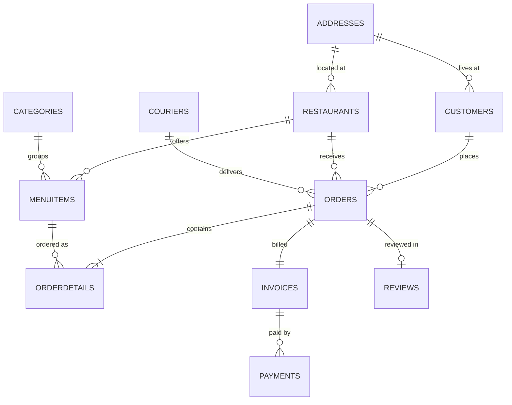

# Food-Delivery Platform Database (MySQL)

**Author:** Francisca (Kika) Freixo  

A normalised relational database for a Thuisbezorgd-style food-delivery platform. It covers customers, restaurants, menus, couriers, orders, invoices, payments and reviews, with sample data and analytical queries.

**SQL (MySQL 8) · ER modelling · normalisation · constraints**

---

## Data model


## Highlights
- **11 tables** with primary and foreign keys, `UNIQUE`, `ENUM` and `CHECK` constraints (for example, commission rate must be between 0 and 100%).
- Realistic **sample data** for every table (all invented).
- **Analytical queries**, including:
  - a restaurant performance report (orders, revenue, commission earned, average rating) using `JOIN`, `GROUP BY` and `HAVING`
  - customers who have never ordered, using a `LEFT JOIN … IS NULL` anti-join

## Running it
```sql
SOURCE schema.sql;   -- creates the `thuisbezorgd` database and loads sample data
SOURCE queries.sql;
```

*Maastricht University, Database Management (2026). Team of 3.*
